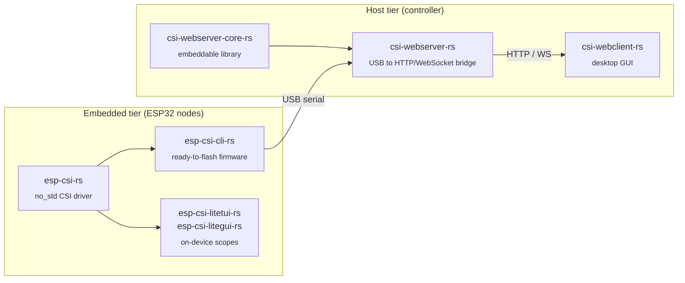

<div align="center">

<picture>
  <source media="(prefers-color-scheme: dark)" srcset="https://raw.githubusercontent.com/csi-rs/.github/main/brand/svg/csi-rs-stacked-dark.svg">
  
</picture>

**Open-source Rust tooling for Wi-Fi Channel State Information (CSI) on ESP32 devices**

From `no_std` firmware on the radio to host-side servers and desktop clients:
collect, stream, visualize, and record CSI with a single, consistent toolchain.

[](https://crates.io/crates/esp-csi-rs)
[](https://crates.io/crates/csi-webserver)
[](https://crates.io/crates/csi-webserver-core)
[](https://crates.io/crates/csi-webclient)

</div>

---

## What is CSI?

Channel State Information describes how a Wi-Fi signal propagates between a
transmitter and a receiver: the amplitude and phase of every subcarrier.
Because people and objects in a room disturb that channel, CSI is the raw
material for Wi-Fi sensing: presence and motion detection, activity
recognition, localization, and more.

csi-rs makes that data easy to get from inexpensive ESP32 boards, using the
terminology of **IEEE 802.11bf** (WLAN Sensing) wherever the standard has one.

## How the pieces fit



## Projects

### Embedded

| Repository | Description |
|---|---|
| [**esp-csi-rs**](https://github.com/csi-rs/esp-csi-rs) | The core `no_std` crate for collecting CSI on ESP32-series devices. Station, sniffer, softAP, raw 802.11 emitter, and ESP-NOW modes, with multiple output formats. |
| [**esp-csi-cli-rs**](https://github.com/csi-rs/esp-csi-cli-rs) | Pre-built firmware with a serial command-line interface. Flash it and configure CSI collection without writing any code. |
| [**esp-csi-litetui-rs**](https://github.com/csi-rs/esp-csi-litetui-rs) | A handheld CSI scope for the M5Stack CoreS3 SE: live visualization and SD-card logging. |
| [**esp-csi-litegui-rs**](https://github.com/csi-rs/esp-csi-litegui-rs) | Live CSI heatmap on ESP32-S3 AMOLED boards (Waveshare, LilyGo T4-S3). |

### Host

| Repository | Description |
|---|---|
| [**csi-webserver-rs**](https://github.com/csi-rs/csi-webserver-rs) | Ready-to-run server that discovers boards over USB and exposes them over HTTP/WebSocket, with optional Parquet session dumps. |
| [**csi-webserver-core-rs**](https://github.com/csi-rs/csi-webserver-core-rs) | The library behind `csi-webserver`, for embedding the CSI server in your own application. |
| [**csi-webclient-rs**](https://github.com/csi-rs/csi-webclient-rs) | Native desktop client for configuring, controlling, and recording one or many devices through `csi-webserver`. |

**Supported chips:** ESP32, ESP32-C3, ESP32-C5, ESP32-C6, ESP32-S3.

## Quick start

1. Flash a board with [`esp-csi-cli-rs`](https://github.com/csi-rs/esp-csi-cli-rs)
   (pre-built binaries are available in its releases).
2. Run the host server:

   ```bash
   cargo install csi-webserver
   csi-webserver
   ```

3. Connect with [`csi-webclient-rs`](https://github.com/csi-rs/csi-webclient-rs),
   or talk to the HTTP/WebSocket API directly.

Prefer to write your own firmware? Add [`esp-csi-rs`](https://crates.io/crates/esp-csi-rs)
to your project and read the
[network model](https://github.com/csi-rs/esp-csi-rs/blob/main/docs/network-model.md).

## Contributing

Issues and pull requests are welcome on any of the repositories above. Please
read our [Code of Conduct](https://github.com/csi-rs/.github/blob/main/CODE_OF_CONDUCT.md)
before participating.

All projects are licensed under **Apache-2.0** unless stated otherwise.
